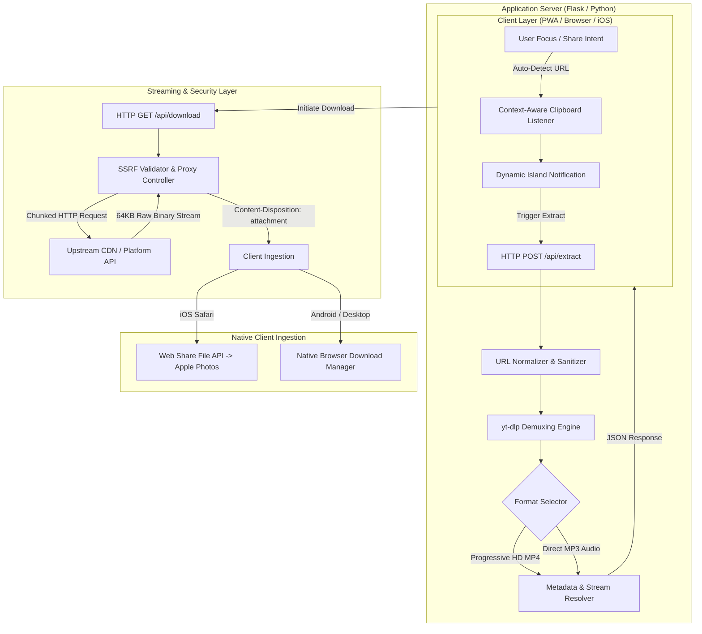

# AshxStudio

[](https://github.com/aswinhub26/AshxStudio/actions)


> **Production Deployment:** [https://ashxstudio.onrender.com/](https://ashxstudio.onrender.com/)  
> **System Status:** Operational (24/7 Active Monitoring via UptimeRobot)

AshxStudio is a high-throughput multimedia extraction and streaming engine built with a Python backend and an iOS-grade responsive web interface. The system provides progressive video demuxing (up to 1080p Full HD) and high-bitrate audio extraction (320kbps MP3) across major content distribution platforms, including **YouTube**, **Instagram**, **TikTok**, **X (Twitter)**, **Facebook**, and **WhatsApp**.

---

## Key Features

- **Multi-Platform Support:** Seamless extraction from YouTube (Videos & Shorts), Instagram (Reels & Posts), TikTok, X (Twitter), Facebook, and WhatsApp status links.
- **SSRF-Protected Streaming Proxy:** Memory-buffered binary proxying (`stream_with_context`) with RFC 1918 / loopback / cloud metadata IP validation.
- **iOS Photos Direct Ingestion:** Leverages the Web Share API to allow iPhone and iPad users to save downloaded MP4 videos directly to Apple Photos.
- **Context-Aware Smart Clipboard:** Automatically detects valid video links copied to the clipboard when returning to the tab.
- **PWA Ready:** Installable as an Android and iOS Progressive Web App with offline service worker caching and share target intent handling.
- **Automated CI/CD:** Continuous Integration matrix on GitHub Actions covering Python 3.10 and 3.11 with unit test automation.

---

## System Architecture & Workflow

The platform operates on a decoupled client-server architecture designed to eliminate local disk I/O bottlenecks and resolve cross-origin resource sharing (CORS) restrictions through real-time binary stream proxying.



---

## REST API Specification

### 1. Service Health Check
```http
GET /api/health
GET /healthz
```

**Response (`200 OK`):**
```json
{
  "status": "healthy",
  "service": "AshxStudio",
  "version": "2.4.0",
  "platforms": [
    "Facebook",
    "Instagram",
    "YouTube",
    "TikTok",
    "X/Twitter",
    "WhatsApp"
  ]
}
```

### 2. Extract Media Metadata
```http
POST /api/extract
Content-Type: application/json

{
  "url": "https://www.youtube.com/shorts/dQw4w9WgXcQ"
}
```

**Response (`200 OK`):**
```json
{
  "success": true,
  "title": "Sample Media Title",
  "thumbnail": "https://...",
  "platform": "YouTube",
  "video": {
    "url": "https://...",
    "download_url": "/api/download?url=https%3A%2F%2F...&title=Sample&ext=mp4",
    "quality": "1080p (Progressive MP4)",
    "ext": "mp4",
    "type": "video"
  },
  "audio": {
    "url": "https://...",
    "download_url": "/api/download?url=https%3A%2F%2F...&title=Sample&ext=mp3",
    "quality": "320kbps MP3 (HQ Audio)",
    "ext": "mp3",
    "type": "audio"
  }
}
```

### 3. Binary Stream Proxy
```http
GET /api/download?url=<ENCODED_STREAM_URL>&title=<OPTIONAL_FILENAME>&ext=<mp4|mp3|m4a>
```
Streams raw upstream media chunks with `Content-Disposition: attachment; filename="..."`. Validates against SSRF, loopback, private RFC 1918 addresses, and link-local ranges.

---

## Tech Stack

| Layer | Technologies |
| :--- | :--- |
| **Backend Runtime** | Python 3.10 & 3.11, Flask, Gunicorn |
| **Core Media Engine** | yt-dlp, Requests |
| **Client Frontend** | Vanilla JavaScript (ES6+), Tailwind CSS, Plus Jakarta Sans, Inter |
| **Mobile Integration** | Service Worker, Web App Manifest, Web Share File API |
| **Security** | SSRF Link-Local/Private IP Filter, Clean URL Normalization |
| **Testing & CI/CD** | Pytest / Unittest, GitHub Actions Multi-Version Matrix |
| **Infrastructure** | Render Web Services, UptimeRobot |

---

## Local Development

### Prerequisites
- Python 3.10 or higher
- Git

### Installation

```bash
# Clone the repository
git clone https://github.com/aswinhub26/AshxStudio.git
cd AshxStudio

# Install required Python packages
pip install -r requirements.txt

# Run the automated test suite
python -m unittest discover -s tests -p "test_*.py"

# Start the local development server
python app.py
```

The application will be accessible at `http://127.0.0.1:5000`.

---

## Production Deployment (Render)

1. Connect the GitHub repository to [Render.com](https://render.com/).
2. Create a new **Web Service** with the following parameters:
   - **Environment:** `Python 3`
   - **Build Command:** `pip install -r requirements.txt`
   - **Start Command:** `gunicorn app:app`
   - **Plan:** `Free`
3. Configure an automated 5-minute health check monitor via UptimeRobot targeting `/healthz` to avoid cold-start instance spin-down.

---

## License

This project is licensed under the MIT License.
